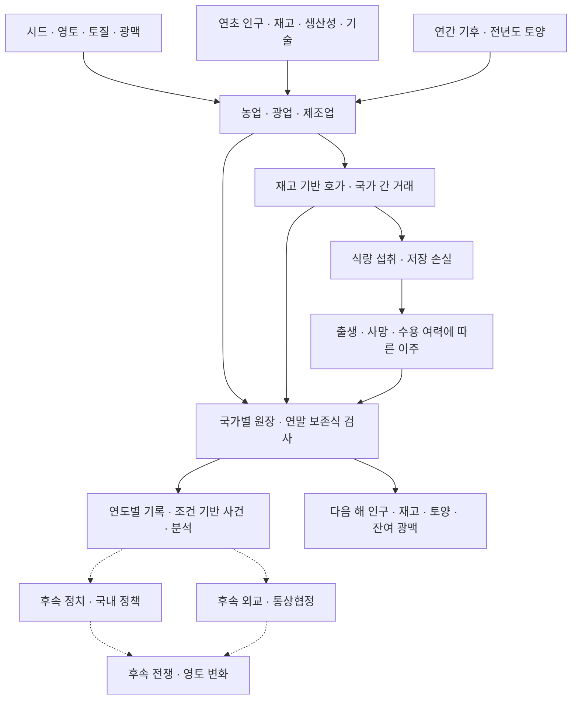

# 1차 엔진 설계

**목표**는 같은 초기 조건과 규칙으로 같은 물적 흐름을 재구성하고, 연말에 실제로 발생한 식량 부족·광맥 고갈·인구 이동을 기록하는 것이다. 시간 단위는 1년이다. 세계의 기본값은 48×32 타일, 8개 국가, 50년이다.

## 연간 경계

[편집 가능한 tldraw 설계도](https://www.tldraw.com/f/0bUzL9_Y5-sq8tpY7HMM6)

1. 지도 생성기가 시드로 영토와 자원을 만들고 국가별로 집계한다. 타일은 초기 자료이고 매년 변하는 토양 상태와 남은 매장량은 국가별로 관리한다.
2. 연초 인구·재고를 복사한다. 기후, 토지와 노동을 투입해 작물과 광석을 얻고 광석을 도구로 가공한다.
3. 국가별 호가·수량으로 거래를 체결한다. 한 국가의 지불과 다른 국가의 수입을 같은 체결 기록으로 남긴다.
4. 물자를 소비하고 연초 인구의 실제 섭취량으로 자연 증감을 계산한다. 이주는 동일 시점의 여력을 기준으로 정산한다.
5. 독립 검사기가 다음 등식을 국가별로 재구성한다. 일치한 연도만 기록한다.

| 검사항목 | 등식 |
| --- | --- |
| 재화별 기말량 | 기초량 + 생산 − 생산 투입 + 수입 − 수출 − 소비·손실 |
| 현금 | 기초액 + 수출 대금 − 수입 대금 |
| 지하 매장량 | 기초 매장량 − 채굴량 |
| 인구 | 기초 인구 + 출생 − 사망 + 전입 − 전출 |
| 세계 인구 | 기초 인구 + 출생 − 사망 |

## 저장 및 확장

모델·경제·인구 모듈은 파일을 쓰지 않는다. 연간 조정 모듈이 입력 스냅샷, 계산 근거와 결과를 결합한다. 실행 저장 모듈은 초기 지도와 국가 상태를 JSON으로, 연간 원장을 한 줄 한 해인 JSONL로 쓴다. 새 실행 디렉터리로 원자적으로 게시하고 기존 실행의 기록을 보호한다. 분석은 이 파일을 순차 조회한다.

정치와 외교는 연말 스냅샷을 읽고 다음 해의 정책·통상 제약을 산출하는 단계로 추가할 수 있다. 전쟁에서 영토나 물자가 이동하면 양쪽 국가가 대응하는 이체 항목을 남기도록 원장 및 보존식부터 확장해야 한다.

## 구현·검증 순서

지도와 초기화 → 부문별 생산·시장 및 인구 단위 테스트 → 독립 원장 검사 → 저장·재실행·분석 통합 테스트 → 기본 설정 실측과 국가 수·지도 크기 확장 실측. 결과 수치를 얻은 뒤 사례를 선정한다. 계수는 가상의 모의실험을 위한 가정이다.

